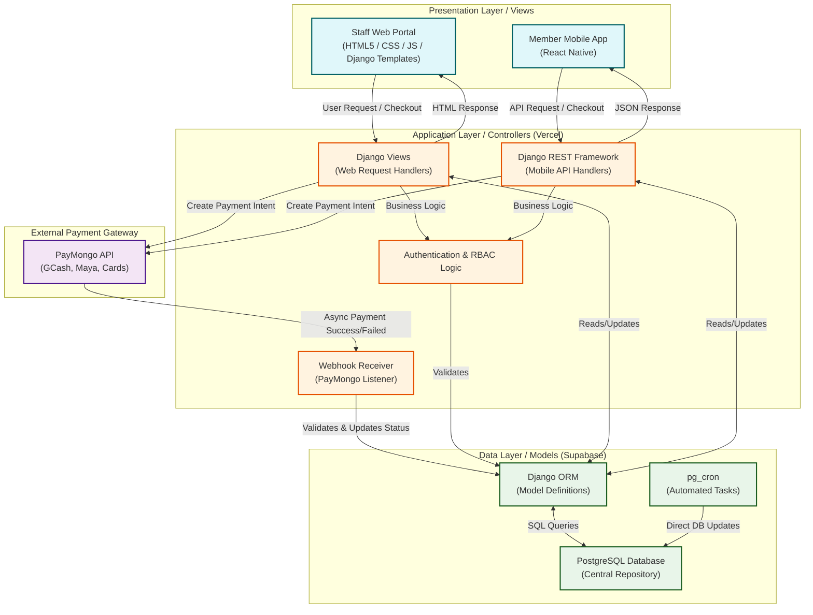

# ProFit Architecture

The system follows a layered architecture (Presentation, Application, Data) with MVC separation (Django ORM models, Django templates / mobile app views, Django views / DRF controllers) around a central data store (Supabase PostgreSQL).

